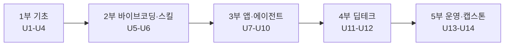

# 학습 계획안 (대주제 14개 · 대주제마다 챕터 5개)

> 대상: 파이썬 기초 + LLM 코딩으로 배포해 본 경험 있음
> 중점: 프롬프트 엔지니어링 · 소프트웨어 딥테크 전반 · 최신 스킬 트렌드 · 바이브코딩 잡지식
> 원래 프롬프트의 커리큘럼에서 바꾼 점은 맨 아래에 정리

> 날짜에 묶지 않는다. 원할 때 다음 챕터를 이어서 하고, 진도는 끝낸 레슨으로 센다.

## 챕터 하나 (30분 안팎)

| 시간 | 할 일 |
|---|---|
| 15분 | 읽기 (개념 + 그림 + 예시) |
| 10분 | 손으로 해보기 (Claude Code / Codex / ChatGPT / Gemini에서 직접 실행) |
| 5분 | 확인 문제 3개 |

**마지막 챕터(5챕터)**는 그 대주제 내용을 쓰는 작은 실습 1개 + **바이브코딩 잡지식 카드 3장**입니다.

## 대주제 14개

| 주 | 모듈 | 핵심 | 결과물 |
|---|---|---|---|
| **1부 기초** ||||
| U1 | LLM은 어떻게 동작하나 | 토큰, 컨텍스트, 샘플링, 사전학습→RLHF→추론 모델. 수학 없이 직관만 | 같은 질문을 temperature를 바꿔 비교한 메모 |
| U2 | 프롬프트 엔지니어링 기본 | 명확한 지시, 역할, few-shot, XML 구조화, 생각할 공간 주기 | 나쁜 프롬프트 1개를 5단계로 개선 |
| U3 | 프롬프트 엔지니어링 심화 | 시스템 프롬프트 설계, 구조화 출력(JSON), 컨텍스트 엔지니어링, 캐싱, 프롬프트 인젝션 | 내 서비스용 시스템 프롬프트 1개 |
| U4 | 평가(Evals) | 성공 기준, 테스트 세트, LLM-as-judge, 회귀 테스트 | 테스트 20개 + 자동 채점 스크립트 |
| **2부 바이브코딩·스킬** ||||
| U5 | 바이브코딩 실전 | CLAUDE.md / AGENTS.md, 플랜 모드, git으로 되돌리기, 테스트 먼저, 작게 나눠 시키기, Claude Code vs Codex vs Cursor | 내 프로젝트용 CLAUDE.md |
| U6 | Agent Skills와 최신 트렌드 | SKILL.md 구조, description으로 발동 조건 정하기, 스크립트 묶기, 서브에이전트·훅·플러그인, 공개 스킬 저장소 둘러보기 | 내 반복 작업 1개를 스킬로 만들기 |
| **3부 앱·에이전트** ||||
| U7 | 도구 사용과 RAG | function calling, 임베딩, 청킹, 재순위, Contextual Retrieval | 내 노트를 검색해 답하는 미니 챗봇 |
| U8 | MCP | 서버·클라이언트·도구·리소스, 보안 범위 | 나만의 MCP 서버를 Claude Code에 연결 |
| U9 | 에이전트 설계 | 워크플로 vs 에이전트, 5가지 패턴, 멀티 에이전트 비용, 도구 설명 잘 쓰기 | 리서치 에이전트(검색→요약→검증) |
| U10 | LLM으로 멋진 웹 만들기 | 디자인 토큰 지정, "AI 티" 피하기, Tailwind·shadcn/ui, 애니메이션, 스크린샷으로 반복 개선, Lighthouse | 랜딩 페이지 3회 개선 전/후 비교 |
| **4부 딥테크** ||||
| U11 | 딥테크 ① 모델 | 파인튜닝·LoRA, 양자화, 증류, 오픈 모델(Llama·Qwen·DeepSeek 등), 추론 모델, 멀티모달, MoE | 용어 지도 1장 (무엇이 무엇과 이어지나) |
| U12 | 딥테크 ② 인프라 | GPU·HBM, 추론 서빙(vLLM 등), KV 캐시, 지연과 비용 구조, 로컬 LLM(Ollama), 벡터 DB, 엣지·서버리스 | 로컬 모델 1개 실행해 보고 API와 비교 |
| **5부 운영·캡스톤** ||||
| U13 | 운영·보안 + 잡지식 총정리 | 모델 라우팅, 배치, 비밀값 관리, 비용 폭탄 사례, LLM 보안(OWASP LLM Top 10), 바이브코딩 사고 사례 | 내 서비스 점검표 |
| U14 | 트렌드 따라가기 + 캡스톤 | 논문·뉴스 읽는 법, 볼 만한 피드 목록, U02~U13을 합친 결과물 1개 | 캡스톤: 스킬 + MCP + 웹 UI를 갖춘 작은 서비스 |

## 대주제마다 반복하는 고정 코너

- **잡지식 카드 3장 (5챕터)**: 바이브코딩 팁·함정·명령어. 14개 대주제면 42장이 쌓이고, 마지막에 치트시트로 묶습니다.
- **트렌드 한 줄 (5챕터)**: 그 대주제와 관련된 최신 소식 1개 (출처·날짜 포함).
- **3사 비교표**: 해당되는 모듈마다 Anthropic · OpenAI · Google Gemini를 비교합니다.

## 원래 커리큘럼에서 바꾼 점

| 바꾼 점 | 이유 |
|---|---|
| 모듈 0(환경 준비) 삭제 → README에 링크만 | 배포 경험이 있어 필요 없음 |
| 모듈마다 2~4시간 → 30분짜리 챕터 5개 | 한 번에 30분 안팎, 날짜에 묶지 않음 |
| "바이브코딩 실전" 모듈 새로 추가 (U5) | 중점 영역 |
| 스킬 모듈을 앞으로 당김 (U6) | 중점 영역이고, 뒤 모듈 실습에서 계속 쓰게 됨 |
| 딥테크 모듈 2개 새로 추가 (U11–12) | "소프트웨어 딥테크 폭넓은 지식" 요청 |
| 운영 모듈에 보안·사고 사례를 합침 (U13) | 바이브코딩으로 배포할 때 가장 흔한 사고 영역 |
| 수학·논문 세부 내용 축소 | 직관 위주 요청. 논문은 "한 줄 요약 + 그림 1개"로만 |

## 다음 단계

이 계획이 괜찮으면 `LLM_study/README.md`, `sources.md`(검색으로 링크 확인), `modules/01_how_llms_work.md`(U01, 챕터 1~5) 순서로 만듭니다.
